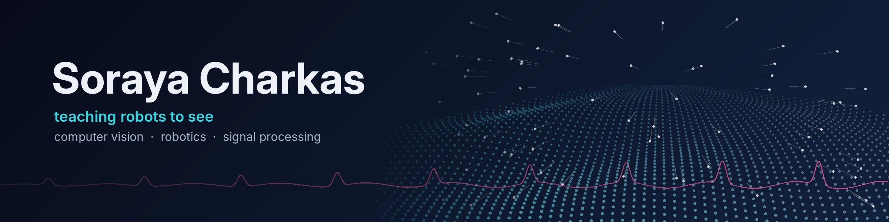

I work on the part of robotics where sensor data turns into decisions: cameras, load cells, physiological signals. EE background ([Sharif](https://www.sharif.edu/) BSc, [UTwente](https://www.utwente.nl/) MSc in Computer Vision), currently interning at **Lely**.

#### Some things I've worked on

| | |
|---|---|
| **Lely** | Wall-touch detection from load-cell data for an autonomous barn robot's localization. Fewer false positives *and* negatives; now being ported to C++ for tests on the real robot. |
| **VicarVision** | Benchmarked 28 rPPG methods on 4 datasets. Cut face-tracking error up to 5×, then fine-tuned a model for 3× accuracy across skin tones. |
| **RDW Self-Driving Challenge** | Object-recognition pipeline for a self-driving car, validated sim-to-real. |
| **Sharif** | EEG channel selection: SVM accuracy 79% → 87%, contributed to an IEEE paper. |

#### Tools

Currently getting much better at modern C++, ROS 2 and simulation. Progress lives in [robotics-learning](https://github.com/SorayaCharkas/robotics-learning).

[LinkedIn](https://linkedin.com/in/Soraya-Charkas)
