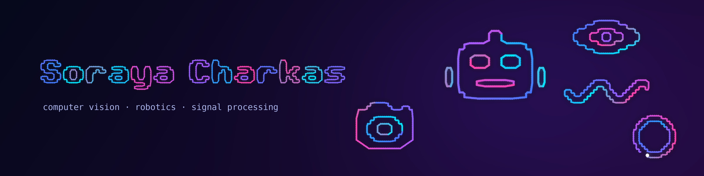

I work where robotics meets computer vision. BSc Electrical Engineering at [Sharif University of Technology](https://www.sharif.edu/), MSc Electrical Engineering (Computer Vision) at the [University of Twente](https://www.utwente.nl/), now at **Lely**.

#### Selected work

- **Lely**: contact detection for a barn robot's localization, from Python to C++
- **VicarVision**: benchmarked 28 rPPG methods, cut face-tracking error up to 5×
- **RDW Self-Driving Challenge**: object recognition for a self-driving car, sim to real
- **Sharif University of Technology**: EEG channel selection, accuracy 79% → 87% (IEEE paper)

#### Tools

Learning now: modern C++, ROS 2, simulation → [robotics-learning](https://github.com/SorayaCharkas/robotics-learning)

[LinkedIn](https://linkedin.com/in/Soraya-Charkas)
